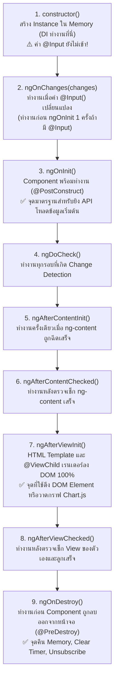

# 📘 คู่มือเจาะลึก Angular ตั้งแต่เริ่มต้นจนถึงระดับสถาปัตยกรรม (Modern Angular v17-19+ Standalone Architecture)
## สำหรับนักพัฒนาสาย Backend (Java Spring Boot / C# .NET / Node.js) เพื่อเตรียมตัวสอบและใช้งานจริง

---

## สารบัญ (Table of Contents)
- [บทที่ 1: ภาพรวมสถาปัตยกรรม Angular (เปรียบเทียบ Backend vs Frontend)](#บทที่-1-ภาพรวมสถาปัตยกรรม-angular-เปรียบเทียบ-backend-vs-frontend)
- [บทที่ 2: การอัปเกรดเวอร์ชัน (`ng update`, `update.angular.io`, วิธีเช็กของใหม่และตัวที่ Obsolete/Deprecated)](#บทที่-2-การอัปเกรดเวอร์ชัน-ng-update-updateangulario-วิธีเช็กของใหม่และตัวที่-obsoletedeprecated)
- [บทที่ 3: เจาะลึก Component, Template Syntax (`@if`, `@for`, `@defer`), Data Binding และ Component Communication](#บทที่-3-เจาะลึก-component-template-syntax-if-for-defer-data-binding-และ-component-communication)
- [บทที่ 4: Angular Lifecycle Hooks ครบทั้ง 8 ลำดับ พร้อมแผนภาพและข้อควรระวัง](#บทที่-4-angular-lifecycle-hooks-ครบทั้ง-8-ลำดับ-พร้อมแผนภาพและข้อควรระวัง)
- [บทที่ 5: RxJS, Observable, Subscribe และ Operators สำคัญ (พร้อมวิธีป้องกัน Memory Leak)](#บทที่-5-rxjs-observable-subscribe-และ-operators-สำคัญ-พร้อมวิธีป้องกัน-memory-leak)
- [บทที่ 6: Angular Signals (`signal`, `computed`, `effect`, `asReadonly`) และการเปลี่ยนผ่านสู่ Zoneless](#บทที่-6-angular-signals-signal-computed-effect-asreadonly-และการเปลี่ยนผ่านสู่-zoneless)
- [บทที่ 7: Frontend Security เชิงลึก (XSS, CSRF, JWT Storage, Interceptor, Route Guard)](#บทที่-7-frontend-security-เชิงลึก-xss-csrf-jwt-storage-interceptor-route-guard)
- [บทที่ 8: Performance Optimization (ระดับ Bundle/Network และระดับ Runtime/Change Detection)](#บทที่-8-performance-optimization-ระดับ-bundlenetwork-และระดับ-runtimechange-detection)
- [บทที่ 9: การเขียน Unit Test ด้วย Jasmine & TestBed (โครงสร้าง AAA, Mocking, HttpTestingController)](#บทที่-9-การเขียน-unit-test-ด้วย-jasmine--testbed-โครงสร้าง-aaa-mocking-httptestingcontroller)

---

## บทที่ 1: ภาพรวมสถาปัตยกรรม Angular (เปรียบเทียบ Backend vs Frontend)

หากคุณมาจากสาย Backend (เช่น Spring Boot หรือ ASP.NET Core) คุณจะพบว่า **Angular คือ Framework ฝั่ง Frontend ที่มีโครงสร้างทางวิศวกรรมใกล้เคียงกับ Backend มากที่สุด** เพราะใช้แนวคิด Dependency Injection (DI), Decorators (Annotations), Separation of Concerns และ Reactive Programming เหมือนกันทุกประการ

### 1.1 ตารางเปรียบเทียบแนวคิด Backend vs Modern Angular (v17-19+)

| แนวคิดในฝั่ง Backend (Spring Boot / .NET) | แนวคิดในฝั่ง Angular (v17-19+ Standalone) | หน้าที่และการทำงาน |
| :--- | :--- | :--- |
| `main()` + `SpringApplication.run()` / `Program.cs` | `main.ts` + `bootstrapApplication(App, appConfig)` | จุดเริ่มต้นรันแอปพลิเคชันและสร้าง Root DI Container |
| `@Configuration` / `builder.Services.Add...` | `app.config.ts` (`ApplicationConfig.providers`) | ลงทะเบียน Global Providers เช่น Router, HttpClient, Interceptors |
| `@RestController` / `@Controller` (MVC View) | `@Component({ standalone: true, ... })` | ควบคุมการแสดงผลหน้าจอ (View) และรับ Event จากผู้ใช้ |
| `@Service` / `@Repository` (Singleton Bean) | `@Injectable({ providedIn: 'root' })` | จัดการ Business Logic, เก็บ Shared State และยิง HTTP API (เป็น Singleton ทั้งแอป) |
| `@Autowired` / Constructor Injection | `inject(MyService)` หรือ `constructor(private s: MyService)` | ขอ Instance ของ Service จาก DI Container โดยไม่ต้อง `new` เอง |
| `Filter` / `HandlerInterceptor` / `Middleware` | `HttpInterceptorFn` (`withInterceptors([...])`) | ดักจับทุก HTTP Request ขาออก (เช่น แนบ JWT) และดัก Response ขากลับ (เช่น ดัก 401) |
| `@PreAuthorize` / `[Authorize]` Guard | `CanActivateFn` (Functional Route Guard) | ตรวจสอบสิทธิ์ก่อนอนุญาตให้เปิดหน้า Route นั้นๆ (เช่น `/admin`) |
| DTO (Data Transfer Object) / Record | TypeScript `interface` หรือ `type` | กำหนดโครงสร้างข้อมูลรับ-ส่งแบบ Static Type Checking ตอน Compile |
| Project Reactor (`Flux<T>`, `Mono<T>`) | RxJS `Observable<T>` | จัดการข้อมูลแบบ Asynchronous Stream และ Event ต่อเนื่องตามเวลา |

### 1.2 ทำไมยุคใหม่ถึงใช้ Standalone Architecture (ไม่ใช้ `@NgModule` แล้ว)?
- **ยุคเก่า (Angular v2 - v14):** ทุก Component ต้องถูกนำไปประกาศใน `declarations: [...]` ของ `@NgModule` (เช่น `AppModule`) เปรียบเหมือนต้องคอยจดทะเบียนคลาสในไฟล์ XML กลางตลอดเวลา ถ้าลืมประกาศก็พัง และทำ Tree-shaking (ตัดโค้ดที่ไม่ได้ใช้ออก) ได้ยาก
- **ยุคใหม่ (Angular v17-19+):** ทุก Component เป็น **Standalone (`standalone: true` เป็นค่าเริ่มต้นตั้งแต่ Angular 19+)** คือพึ่งพาตัวเองได้ 100% อยากใช้ `CommonModule`, `FormsModule` หรือ Child Component ตัวไหน ก็ใส่ใน `imports: [...]` ของ `@Component` ตัวนั้นได้ทันที ทำให้ทำ Lazy Loading ราย Component (`loadComponent`) ได้ง่ายและลดขนาดไฟล์ Bundle ลงอย่างมหาศาล

---

## บทที่ 2: การอัปเกรดเวอร์ชัน (`ng update`, `update.angular.io`, วิธีเช็กของใหม่และตัวที่ Obsolete/Deprecated)

ในข้อสอบและการทำงานจริงในฐานะ Senior Architect การวางแผนอัปเกรดเวอร์ชัน Angular อย่างปลอดภัยคือหัวใจสำคัญ

### 2.1 ขั้นตอนมาตรฐานในการอัปเกรดเวอร์ชัน
1. **ตรวจสอบคู่มืออย่างเป็นทางการที่ `https://angular.dev/update-guide` (หรือ `update.angular.io`):**
   - เลือกเวอร์ชันต้นทาง (เช่น v16) และปลายทาง (เช่น v19)
   - ระบบจะสรุปสิ่งที่ต้องเตรียม เช่น เวอร์ชันขั้นต่ำของ **Node.js**, **TypeScript**, และ **RxJS** ที่รองรับ
2. **กฎเหล็ก: อัปเกรดทีละ 1 Major Version เสมอ!**
   - เช่น หากอยู่ v16 แล้วจะไป v19 ต้องอัปเกรด `16 ➔ 17 ➔ 18 ➔ 19` ตามลำดับ เพื่อให้ **Angular Schematics (สคริปต์แปลงโค้ดอัตโนมัติ)** ทำงานปรับแก้โค้ดที่ Deprecated ให้ครบถ้วนในแต่ละรุ่น
3. **คำสั่ง CLI ที่ใช้ในการตรวจสอบและอัปเกรด:**
   ```bash
   # 1. ตรวจสอบว่าแพ็กเกจใดบ้างในโปรเจกต์ที่มีเวอร์ชันใหม่ให้อัปเดต
   ng update

   # 2. สั่งอัปเกรด Angular Core และ Angular CLI พร้อมรัน Migration Schematics อัตโนมัติ
   ng update @angular/core @angular/cli
   ```

### 2.2 สรุปฟีเจอร์เก่าที่ Obsolete/Deprecated vs ฟีเจอร์ใหม่ที่เข้ามาแทนที่ (ออกสอบบ่อยมาก!)

| ของเดิม (Deprecated / Legacy) | ของใหม่ใน Modern Angular (v17-19+) | คำสั่ง автоматического Migration (Schematics) |
| :--- | :--- | :--- |
| `@NgModule` (`AppModule`) | **Standalone Components** (`bootstrapApplication`) | `ng generate @angular/core:standalone` |
| `*ngIf`, `*ngFor`, `*ngSwitch` | **Built-in Control Flow (`@if`, `@for`, `@switch`)** | `ng generate @angular/core:control-flow` |
| Constructor DI (`constructor(private s: S)`) | **`inject()` function** (`private s = inject(S)`) | `ng generate @angular/core:inject` |
| Class-based Guards & Interceptors | **Functional `CanActivateFn` & `HttpInterceptorFn`** | เขียนเป็น Arrow Function สั้นๆ แทนคลาส |
| `@Input()` / `@Output()` Decorators | ใช้ได้ทั้ง `@Input()/@Output()` และ **`input()` / `output()` Signals** | `ng generate @angular/core:signal-inputs` |
| Karma + Jasmine Test Builder | **`@angular/build:unit-test`** (รองรับ Vitest / Modern Web Test Runner) | ตั้งค่าใน `angular.json` |

---

## บทที่ 3: เจาะลึก Component, Template Syntax (`@if`, `@for`, `@defer`), Data Binding และ Component Communication

### 3.1 Data Binding ทั้ง 4 รูปแบบหลัก
1. **Interpolation (`{{ expression }}`):** แสดงค่าตัวแปรหรือ Signal จาก TypeScript ลงบน HTML (ทิศทาง: `Component ➔ DOM`)
2. **Property Binding (`[property]="value"`):** ผูกค่าตัวแปรเข้ากับ HTML Property หรือ `@Input()` ของลูก (ทิศทาง: `Component ➔ DOM/Child`)
3. **Event Binding (`(event)="handler($event)"`):** ดักจับเหตุการณ์จากผู้ใช้ (เช่น `(click)`) หรือ `@Output()` จากลูก (ทิศทาง: `DOM/Child ➔ Component`)
4. **Two-Way Binding (`[(ngModel)]="property"`):** ผสาน Property Binding + Event Binding เข้าด้วยกัน ("Banana in a Box" `[()]`) เมื่อผู้ใช้พิมพ์ในช่อง `<input>` ค่าตัวแปรในคลาสจะเปลี่ยนทันที และถ้าตัวแปรในคลาสเปลี่ยน หน้าจอก็เปลี่ยนตาม (ต้อง import `FormsModule`)

### 3.2 Built-in Control Flow ยุคใหม่ (`@if`, `@for`, `@defer`)
ไม่ต้อง import `CommonModule` เพื่อใช้ `*ngIf` / `*ngFor` อีกต่อไป และทำงานเร็วกว่าเดิมเพราะคอมไพล์เป็นคำสั่งระดับ Runtime โดยตรง:

```html
<!-- 1. การตรวจสอบเงื่อนไขด้วย @if / @else -->
@if (employees().length > 0) {
  <!-- 2. การวนลูปด้วย @for (บังคับต้องมี track เสมอ!) -->
  @for (emp of employees(); track emp.id; let idx = $index) {
    <div>#{{ idx + 1 }} - {{ emp.name }}</div>
  }
} @else {
  <p>ไม่พบข้อมูลพนักงาน</p>
}

<!-- 3. Deferrable Views (@defer): แยก Chunk โหลดเฉพาะเมื่อเลื่อนหน้าจอมาถึง! -->
@defer (on viewport) {
  <app-heavy-analytics-chart />
} @placeholder {
  <div>เลื่อนลงมาเพื่อดูกราฟ...</div>
} @loading (minimum 200ms) {
  <div>กำลังโหลดกราฟ...</div>
} @error {
  <div>โหลดกราฟไม่สำเร็จ</div>
}
```
> **ทำไม `@for` ถึงบังคับใส่ `track emp.id`?**
> เพราะในยุค `*ngFor` นักพัฒนามักลืมใส่ `trackBy` ทำให้เวลาข้อมูลใน Array เปลี่ยนแค่ 1 ตัว Angular ต้องทุบ DOM `<li>` ทั้งหมดทิ้งแล้วสร้างใหม่ (เปลือง CPU และหน้าจอกระตุก) การบังคับ `track emp.id` ช่วยให้ Angular อ้างอิง Primary Key ของข้อมูลเพื่ออัปเดตเฉพาะแถวที่เปลี่ยนจริงๆ เท่านั้น!

### 3.3 การสื่อสารระหว่าง Component (Component Communication) ทั้ง 2 รูปแบบหลัก
1. **แบบแม่-ลูก (Parent-Child Communication):**
   - **Parent ส่งให้ Child:** ใช้ `@Input()` ในตัวลูก และส่งค่าจากตัวแม่ด้วย `<app-child [salary]="parentSalary" />` (เปรียบเสมือนส่ง Method Arguments / Request DTO)
   - **Child ส่งกลับหา Parent:** ใช้ `@Output() bonusCalculated = new EventEmitter<ResultDto>()` ในตัวลูก สั่งยิงด้วย `this.bonusCalculated.emit(payload)` และตัวแม่ดักรับด้วย `<app-child (bonusCalculated)="onResult($event)" />` (เปรียบเสมือน Callback / Domain Event)
2. **แบบพี่น้องหรืออยู่คนละกิ่ง (Sibling / Cross-Tree Communication):**
   - ใช้ **Shared Singleton Service (`@Injectable({ providedIn: 'root' })`) ร่วมกับ Angular Signals (`signal()`, `computed()`, `asReadonly()`)**
   - Sibling A เรียกเมธอดของ Service เพื่ออัปเดต Signal ต้นทาง ส่วน Sibling B อ่านค่าจาก Read-only Signal หรือ Computed Signal ไปแสดงผลแบบ Real-time ทันทีโดยไม่ต้องผ่านตัวแม่!

---

## บทที่ 4: Angular Lifecycle Hooks ครบทั้ง 8 ลำดับ พร้อมแผนภาพและข้อควรระวัง

เหมือนที่ Spring Bean มี `@PostConstruct` และ `@PreDestroy` ตัว Angular Component ก็มีวงจรชีวิตตั้งแต่ถูกสร้าง (`new`) จนกระทั่งถูกทำลายออกจาก DOM

### 4.1 แผนภาพลำดับการทำงานของ Lifecycle Hooks



### 4.2 ข้อควรระวังที่ออกสอบบ่อยที่สุด
1. **`constructor` vs `ngOnInit`:**
   - `constructor` มีไว้เพื่อทำ Dependency Injection เท่านั้น (หากไม่ได้ใช้ `inject()`) ณ จังหวะที่ `constructor` ทำงาน **ค่า `@Input()` ที่ตัวแม่ส่งเข้ามาจะยังเป็น `undefined` (หรือค่าเริ่มต้น)**
   - ดังนั้น หากต้องยิง API โดยใช้ค่าจาก `@Input()` (เช่น `userId`) **ต้องทำใน `ngOnInit` หรือ `ngOnChanges` เสมอ!**
2. **การเข้าถึง DOM (`@ViewChild`):**
   - ถ้าคุณพยายามอ่านค่า `@ViewChild('myCanvas')` ใน `ngOnInit()` คุณจะได้ `undefined` เพราะ DOM ยังวาดไม่เสร็จ ต้องรอให้อ่านใน **`ngAfterViewInit()`** เท่านั้น
3. **การป้องกัน Memory Leak ใน `ngOnDestroy()`:**
   - หากมีการตั้ง `setInterval`, เปิด WebSocket, หรือทำ `.subscribe()` กับ Observable ที่ไม่จบเอง ต้องยกเลิกใน `ngOnDestroy()` (หรือใช้ `takeUntilDestroyed()` ใน Angular ยุคใหม่) เสมอ

---

## บทที่ 5: RxJS, Observable, Subscribe และ Operators สำคัญ (พร้อมวิธีป้องกัน Memory Leak)

### 5.1 Observable vs Promise (เปรียบเทียบให้เห็นภาพชัดเจน)

| คุณสมบัติ | `Promise<T>` | RxJS `Observable<T>` (เหมือน `Flux<T>` ใน WebFlux) |
| :--- | :--- | :--- |
| **จำนวนค่าที่ส่งออกมา** | ส่งค่าได้แค่ **1 ครั้งเดียว** (Resolve หรือ Reject แล้วจบเลย) | ส่งค่าออกมาได้ **หลายครั้งต่อเนื่องตามเวลา (Stream)** เช่น ค่าการพิมพ์คีย์บอร์ด หรือ WebSocket |
| **การทำงาน (Execution)** | **Eager:** ทำงานทันทีที่สร้าง `new Promise(...)` | **Lazy (Cold Observable):** **ไม่ทำงานเลยจนกว่าจะมีคนสั่ง `.subscribe()`!** |
| **การยกเลิก (Cancellation)** | ยกเลิกกลางคันไม่ได้โดยตรง | **ยกเลิกได้ทันทีด้วย `.unsubscribe()` หรือ `switchMap()`** (ยกเลิก HTTP Request ที่กำลังวิ่งอยู่ได้จริง!) |
| **Operators แปลงข้อมูล** | มีแค่ `.then()`, `.catch()` | มี Operators ทรงพลังนับร้อยตัว (`debounceTime`, `switchMap`, `retry`, ฯลฯ) |

### 5.2 เจาะลึกไปป์ไลน์ค้นหาข้อมูล (Typeahead Search Pipeline) ที่ต้องจำขึ้นใจ

```typescript
this.searchControl.valueChanges.pipe(
  debounceTime(300),          // 1. รอให้ผู้ใช้หยุดพิมพ์ครบ 300ms ก่อนค่อยส่งค่าต่อ (ลดการยิง API รัวๆ)
  distinctUntilChanged(),     // 2. ถ้าคำค้นหาเหมือนครั้งก่อนหน้าเป๊ะ ไม่ต้องยิงซ้ำ
  switchMap((keyword) =>      // 3. ถ้ายิงคำใหม่มาขณะคำเก่ายังโหลดไม่เสร็จ ให้ Cancel HTTP Request เก่าทันที!
    this.userApi.searchUsers(keyword).pipe(
      catchError((err) => {   // 4. ดัก Error ด้านใน switchMap เพื่อไม่ให้ Stream หลักตายเมื่อ API พัง
        return of([]);        // คืนค่า Fallback Array ว่างแทน
      })
    )
  ),
  takeUntilDestroyed(this.destroyRef) // 5. Unsubscribe อัตโนมัติเมื่อ Component ถูกทำลาย!
).subscribe((users) => {
  this.users.set(users);
});
```

### 5.3 เปรียบเทียบ Flattening Operators ทั้ง 4 ตัว (ออกสอบสัมภาษณ์และข้อเขียนทุกที่!)
1. **`switchMap`:** มาใหม่ **ยกเลิกตัวเก่าทันที** เอาเฉพาะตัวล่าสุด (เหมาะกับ **การค้นหา Search / GET ข้อมูลล่าสุด**)
2. **`mergeMap` (`flatMap`):** รันทุก Request **พร้อมกันแบบขนาน (Parallel)** ไม่สนใจลำดับก่อนหลัง ไม่มีการยกเลิก (เหมาะกับงานอิสระที่ต้องการความเร็วสูงสุด)
3. **`concatMap`:** เข้าคิวรัน **ทีละตัวเรียงตามลำดับ (Sequential Queue)** รอให้ตัวแรกเสร็จก่อนค่อยเริ่มตัวที่สอง (เหมาะกับงานเรียงลำดับขั้นตอน เช่น อัปโหลดไฟล์ทีละส่วน)
4. **`exhaustMap`:** ถ้ารอบแรกยังทำงานไม่เสร็จ **จะเพิกเฉย (Ignore) คำสั่งใหม่ที่กดรัวเข้ามาทั้งหมด** จนกว่ารอบแรกจะเสร็จ (เหมาะกับ **ปุ่ม Login หรือปุ่มจ่ายเงิน (Submit Payment)** ป้องกันผู้ใช้กดปุ่มรัวๆ ยิงซ้ำ!)

---

## บทที่ 6: Angular Signals (`signal`, `computed`, `effect`, `asReadonly`) และการเปลี่ยนผ่านสู่ Zoneless

### 6.1 ปัญหาของ `Zone.js` แบบดั้งเดิม vs ทำไมต้องใช้ `Signals`?
- **ยุค Zone.js (แบบเดิม):** Angular ใช้ไลบรารี `zone.js` ไปดัก (Monkey-patch) ทุก Async API ของ Browser (เช่น `click`, `setTimeout`, `fetch`) พอเกิด Event ปุ๊บ Zone.js จะตะโกนบอก Angular ว่า *"มีอะไรสักอย่างเปลี่ยน แต่ฉันไม่รู้ว่าตรงไหน เช็ก Component ทั้งหน้าจอเลยนะ!"*
- **ยุค Angular Signals (v16-19+):** `Signal` คือตัวแปรอัจฉริยะที่รู้ว่า **"Template จุดไหนกำลังอ่านค่ามันอยู่"** ทันทีที่เราสั่ง `.set()` หรือ `.update()` มันจะพุ่งไปอัปเดตเฉพาะ DOM จุดนั้นโดยตรง (Fine-grained Reactivity) ปูทางสู่โหมด **Zoneless Angular** ที่ไม่ต้องพึ่งพา `zone.js` อีกต่อไป!

### 6.2 คำสั่งหลักทั้ง 4 ตัวของ Angular Signals
```typescript
// 1. signal(initialValue): สร้าง WritableSignal ที่แก้ไขค่าได้
private readonly _score = signal<number>(75);

// 2. asReadonly(): แปลงเป็น Read-only Signal สำหรับเปิดให้ Component อื่นอ่านอย่างเดียว (Encapsulation)
public readonly score = this._score.asReadonly();

// 3. computed(): สร้าง Derived Signal ที่คำนวณใหม่อัตโนมัติเมื่อต้นทางเปลี่ยน (พร้อมแคชค่า Memoization)
public readonly grade = computed(() => (this._score() >= 80 ? 'A' : 'B'));

// 4. effect(): รัน Side-effect อัตโนมัติเมื่อ Signal ที่ถูกอ่านด้านในเปลี่ยนค่า (เช่น บันทึกลง LocalStorage หรือ Log)
constructor() {
  effect(() => {
    console.log('คะแนนล่าสุดคือ:', this.score(), 'ได้เกรด:', this.grade());
  });
}

// วิธีการแก้ไขค่าใน WritableSignal:
this._score.set(85);                      // ทับค่าใหม่โดยตรง
this._score.update((prev) => prev + 5);   // คำนวณจากค่าเดิม
```

---

## บทที่ 7: Frontend Security เชิงลึก (XSS, CSRF, JWT Storage, Interceptor, Route Guard)

### 7.1 การป้องกัน XSS (Cross-Site Scripting) และ `DomSanitizer`
- **กลไกอัตโนมัติของ Angular:** Angular มองว่าทุกค่าที่มาจากตัวแปรเป็น **Untrusted Value** เสมอ
  - หากแสดงผลด้วย `{{ payload }}` โค้ด `<script>alert(1)</script>` จะถูกแปลงเป็น Text ธรรมดาขึ้นหน้าจอ
  - หากผูกด้วย `[innerHTML]="payload"` Angular จะเรียก `DomSanitizer` ภายในเพื่อตัด `<script>`, `onload`, `onerror` ที่เป็นอันตรายออกให้อัตโนมัติ พร้อมแจ้ง Warning ใน Console
- **การใช้ `DomSanitizer`:**
  - `sanitizer.sanitize(SecurityContext.HTML, rawHtml)` ใช้ชะล้างโค้ดอันตรายให้สะอาด
  - `sanitizer.bypassSecurityTrustHtml(trustedHtml)` ใช้ข้ามการตรวจของ Angular **เฉพาะกรณีที่มั่นใจ 100% ว่าเป็น HTML ที่ระบบสร้างขึ้นเองและปลอดภัยเท่านั้น** (ห้ามนำ Input ดิบจาก User มาใส่ในฟังก์ชันนี้เด็ดขาด!)

### 7.2 การจัดเก็บ JWT Token อย่างปลอดภัย & การป้องกัน CSRF
1. **เก็บ JWT ไว้ที่ไหนปลอดภัยที่สุด?**
   - ❌ **`localStorage` / `sessionStorage`:** เสี่ยงต่อ **XSS** เพราะหากมีสคริปต์หลุดเข้ามาได้ มันสามารถสั่ง `localStorage.getItem('token')` ขโมย Token ไปได้ทันที
   - ✅ **แนวทางที่ปลอดภัยที่สุด (Best Practice):**
     - เก็บ **Refresh Token** ไว้ใน **`HttpOnly, Secure, SameSite=Strict/Lax` Cookie** (JavaScript อ่านไม่ได้ ป้องกัน XSS ขโมย Refresh Token ได้ 100%)
     - เก็บ **Access Token (อายุสั้น 5-15 นาที)** ไว้ใน **In-Memory Variable (ภายใน Angular Singleton Service)** และใช้ `HttpInterceptorFn` แนบเข้า Header `Authorization: Bearer <token>`
2. **การป้องกัน CSRF (Cross-Site Request Forgery):**
   - หากระบบใช้ Cookie ในการยืนยันตัวตน Angular `HttpClient` มีระบบป้องกัน CSRF ในตัว (`withXsrfConfiguration`) โดยจะอ่านค่าคุกกี้ชื่อ `XSRF-TOKEN` ที่ Backend ส่งมา แล้วแนบกลับไปเป็น HTTP Header ชื่อ `X-XSRF-TOKEN` อัตโนมัติ

### 7.3 Functional HTTP Interceptor & Route Guard
- **`HttpInterceptorFn` (`auth.interceptor.ts`):** ต้องทำ `req.clone({ setHeaders: { Authorization: ... } })` เสมอเพราะ `HttpRequest` เป็น Immutable และใช้ `catchError` ดัก `401 Unauthorized` เพื่อจัดการเมื่อ Token หมดอายุ
- **`CanActivateFn` (`auth.guard.ts`):** ป้องกันการเปิดหน้า Route ที่ไม่มีสิทธิ์ หากไม่ผ่านควรคืนค่าเป็น `router.createUrlTree(['/login'])` เพื่อให้ Router Redirect อย่างปลอดภัย (และต้องจำไว้เสมอว่า **Frontend Guard มีไว้เพื่อ UX เท่านั้น ฝั่ง Backend API ต้องตรวจสิทธิ์ซ้ำทุกครั้งเสมอ!**)

---

## บทที่ 8: Performance Optimization (ระดับ Bundle/Network และระดับ Runtime/Change Detection)

การปรับจูนประสิทธิภาพของ Angular แบ่งออกเป็น 2 มิติหลักที่ต้องตอบให้ครบในการสอบ:

### 8.1 ระดับ Bundle & Network (ทำให้โหลดหน้าเว็บครั้งแรกเร็วที่สุด - ลด Initial Load Time)
1. **Lazy Loading Routes (`loadComponent` / `loadChildren`):** แยกโค้ดแต่ละหน้าออกเป็น Chunk ย่อย โหลดเฉพาะหน้าที่ผู้ใช้คลิกเข้าไปดูจริงๆ
2. **Deferrable Views (`@defer (on viewport)`):** แยก Component หนักๆ (เช่น กราฟ, ตารางสถิติ, คอมเมนต์ด้านล่าง) ออกจาก Bundle หลัก และโหลดเมื่อผู้ใช้เลื่อนหน้าจอลงมาเห็นเท่านั้น
3. **`NgOptimizedImage` (`ngSrc`):** ช่วยบีบอัดลำดับการโหลดรูปภาพ ทำ Lazy Load รูปภาพอัตโนมัติ และกำหนด `priority` ให้รูปหลัก (LCP)
4. **SSR (Server-Side Rendering) & Hydration:** เรนเดอร์ HTML จากฝั่ง Server ส่งมาให้แสดงผลทันที ลดเวลา First Contentful Paint (FCP)

### 8.2 ระดับ Runtime & Change Detection (ทำให้ใช้งานลื่นไหล ไม่กระตุก - ลด CPU Usage)
1. **`ChangeDetectionStrategy.OnPush`:** สั่งให้ Angular ข้ามการตรวจเช็ก Component นี้และลูกหลานทั้งหมด หาก `@Input()` ไม่ได้เปลี่ยน Reference, ไม่มี Event ภายใน Component, หรือ Signal ใน Template ไม่ได้เปลี่ยนค่า
2. **ใช้ `Signal` และ `computed()` แทนการเรียกฟังก์ชันใน HTML Template:**
   - ❌ **ห้ามทำ:** `<div>{{ calculateHeavyBonus() }}</div>` เพราะฟังก์ชันนี้จะถูกรันซ้ำทุกๆ รอบที่เกิด Change Detection!
   - ✅ **ควรทำ:** ใช้ `computed(() => ...)` หรือ Pure Pipe เพราะจะคำนวณใหม่เฉพาะเมื่อค่าต้นทางเปลี่ยนเท่านั้น (Memoized)
3. **ใส่ `track item.id` ใน `@for` เสมอ:** เพื่อนำ DOM Node เดิมกลับมาใช้ซ้ำ (DOM Recycling) ไม่ต้องสร้าง Element ใหม่ยกชุด

---

## บทที่ 9: การเขียน Unit Test ด้วย Jasmine & TestBed (โครงสร้าง AAA, Mocking, HttpTestingController)

### 9.1 โครงสร้างมาตรฐาน AAA Pattern และการเปรียบเทียบกับ Backend (JUnit + Mockito)

| แนวคิดการเทสต์ใน Backend (Spring Boot / JUnit) | แนวคิดการเทสต์ใน Angular (Jasmine / Vitest + TestBed) |
| :--- | :--- |
| `@SpringBootTest` / ApplicationContext จำลอง | `TestBed.configureTestingModule({ imports: [...], providers: [...] })` |
| `@Autowired` ดึง Service มาเทสต์ | `TestBed.inject(EvaluationService)` |
| `Mockito.mock(UserApiService.class)` | `jasmine.createSpyObj('UserApiService', ['searchUsers'])` |
| `Mockito.when(mock.searchUsers()).thenReturn(...)` | `mockService.searchUsers.and.returnValue(of(mockUsers))` |
| `@MockBean` แทนที่ Service จริงใน Context | `{ provide: UserApiService, useValue: mockService }` |
| `Assertions.assertEquals(expected, actual)` | `expect(actual).toBe(expected)` หรือ `expect(el.textContent).toContain(...)` |

### 9.2 ตัวอย่างรูปแบบการเทสต์ทั้ง 3 รูปแบบสำคัญ
1. **การเทสต์ Service และ Signals (`evaluation.service.spec.ts`):**
   - ใช้ `TestBed.inject(EvaluationService)`
   - เรียกเมธอดเปลี่ยนค่า Signal แล้วตรวจผลลัพธ์ของ `computed()` ได้ทันทีแบบ Synchronous (ไม่ต้องรอ Async!)
2. **การเทสต์ Component และ DOM Rendering (`bonus-calculator-parent.component.spec.ts`):**
   - ใช้ `const fixture = TestBed.createComponent(MyComponent)`
   - สั่ง `fixture.detectChanges()` และ `await fixture.whenStable()` เพื่อรอให้ Binding และ Async Tasks เสร็จสมบูรณ์
   - ตรวจสอบ HTML จริงด้วย `fixture.nativeElement.querySelector(...)`
3. **การทำ Mock Service ด้วย `jasmine.createSpyObj` (`search-api.component.spec.ts`):**
   - สร้างตัวปลอมด้วย `const spy = jasmine.createSpyObj('UserApiService', ['searchUsers'])`
   - กำหนดค่าตอบกลับจำลองด้วย `spy.searchUsers.and.returnValue(of(mockList))`
   - ฉีดเข้า `providers: [{ provide: UserApiService, useValue: spy }]` เพื่อไม่ให้ Component ยิง HTTP ออกไปหาเซิร์ฟเวอร์จริง
4. **การเทสต์ `HttpClient` ใน Service โดยตรงด้วย `HttpTestingController`:**
   ```typescript
   // ตั้งค่าใน beforeEach:
   TestBed.configureTestingModule({
     providers: [UserApiService, provideHttpClient(), provideHttpClientTesting()]
   });
   const httpMock = TestBed.inject(HttpTestingController);

   // ใน it():
   service.searchUsers('Leanne').subscribe((res) => expect(res.length).toBe(1));
   const req = httpMock.expectOne('https://jsonplaceholder.typicode.com/users');
   expect(req.request.method).toBe('GET');
   req.flush([{ id: 1, name: 'Leanne Graham', username: 'Bret', email: 'a@b.com' }]); // จำลอง Response ขากลับ
   httpMock.verify(); // ตรวจสอบว่าไม่มี Request ตกค้าง
   ```

